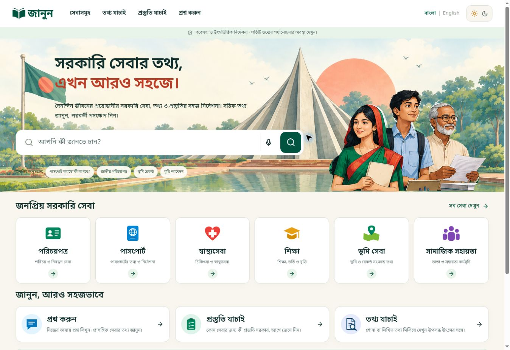
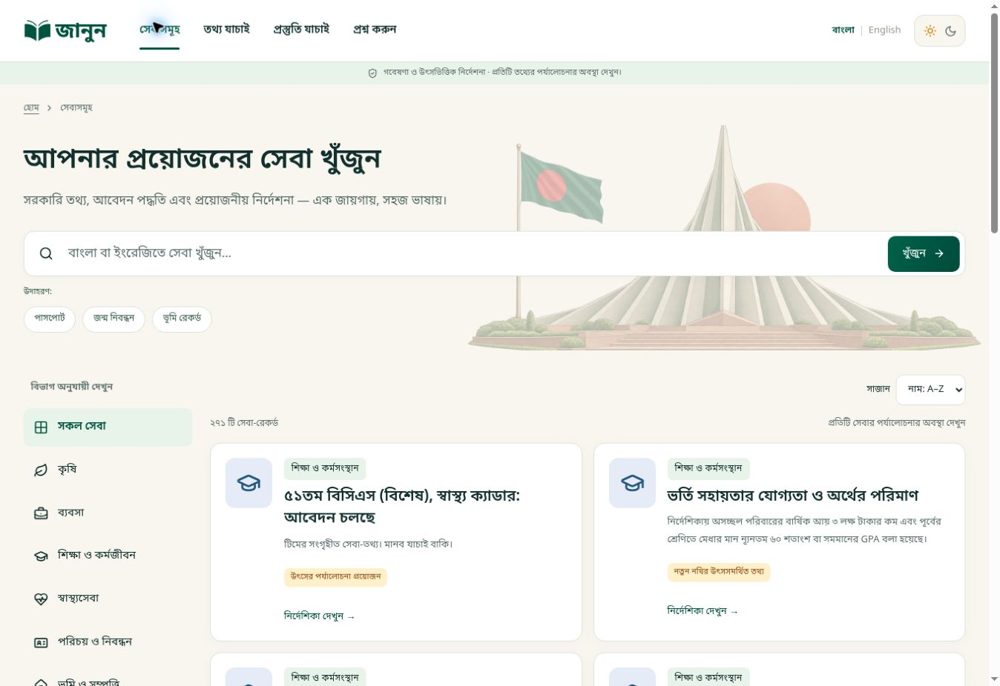
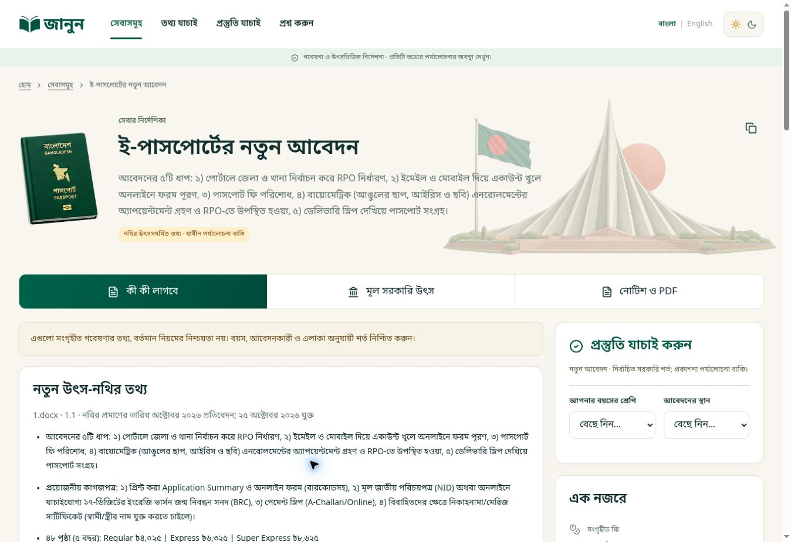
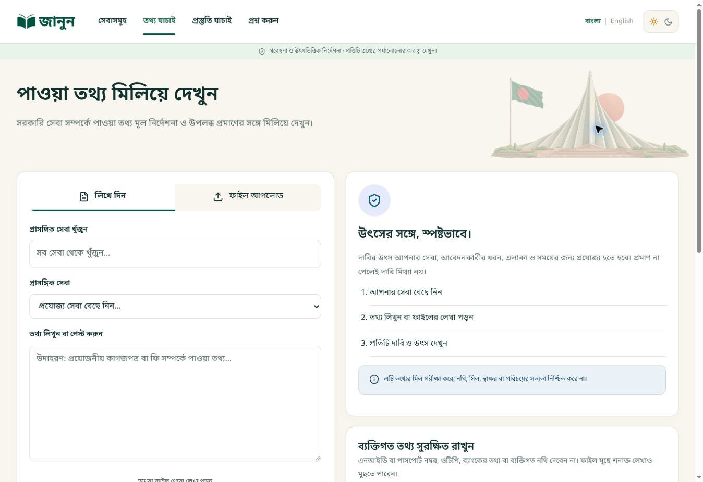
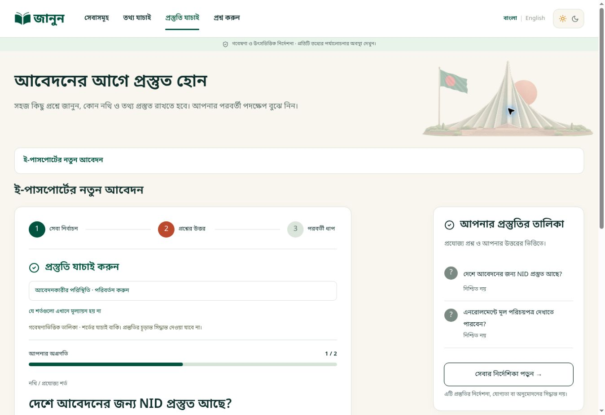
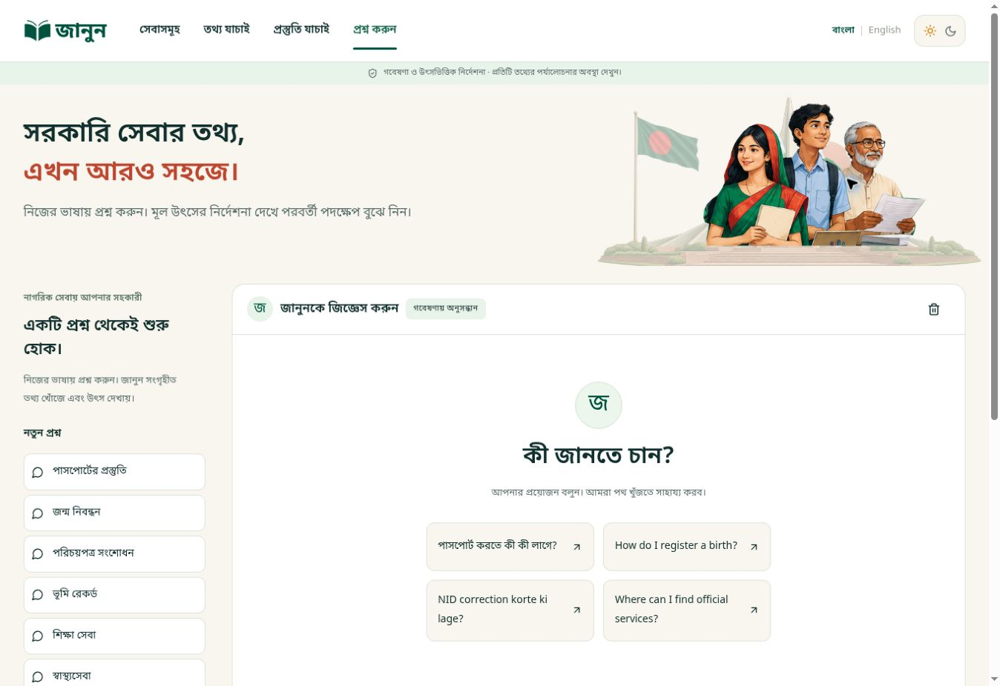
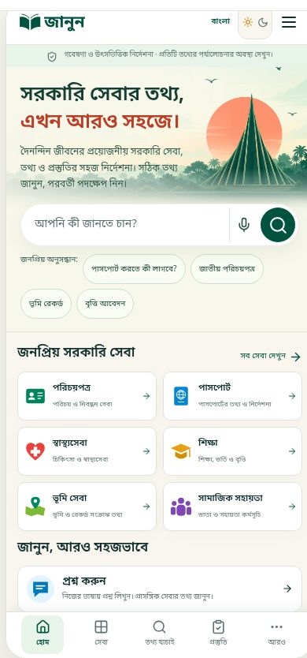
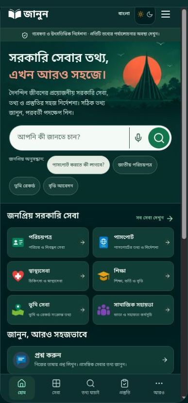
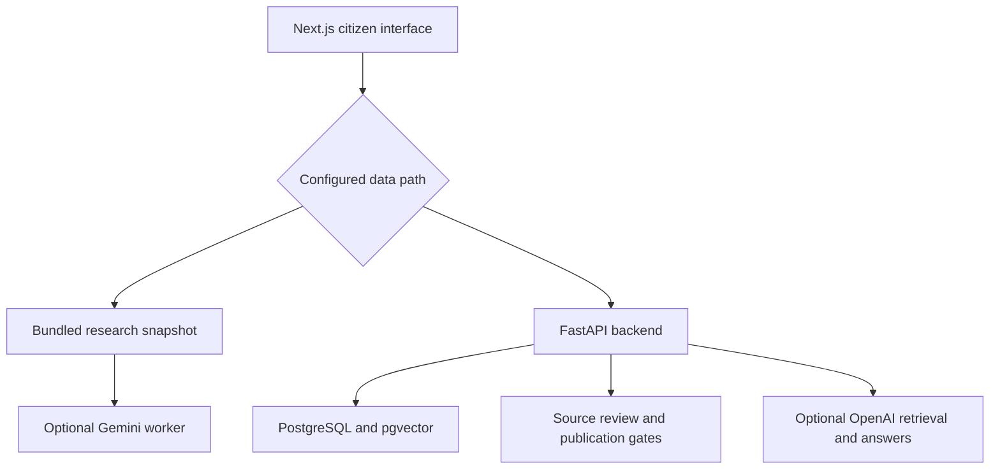

<div align="center">
  <picture>
    <source media="(prefers-color-scheme: dark)" srcset="docs/branding/janun-logo-white.svg" />
    
  </picture>

# জানুন · Janun

**Understand the service. Prepare your documents. Find your next step.**

A Bangla-first guide to Bangladesh citizen services, with source-linked information, preparation checklists and an evidence-bounded assistant.

[Open Janun](https://janun-citizen-guide.dncorleone1211.chatgpt.site/) · [Screenshots](#application-screenshots) · [Local setup](#installation-and-local-setup) · [Reviewer guide](docs/REVIEWER_GUIDE.md)


</div>



*Captured directly from the [live application](https://janun-citizen-guide.dncorleone1211.chatgpt.site/) on 26 October 2026. The gallery shows the current interface; the logo is the live app’s scalable SVG. See [capture details](docs/SCREENSHOTS.md).*

> **Prototype status:** Janun is an independent guide, not a government service or application-submission portal. The included snapshot has **271 service entries across 13 categories**, all marked `needs_review`. Source-confirmed document imports do not constitute independent human verification. Consult the original authority before applying.

## Explore the project

| For citizens and clients | For developers | For judges and reviewers |
| --- | --- | --- |
| [Problem and solution](#problem-and-solution) | [Architecture](#technology-and-architecture) | [Five-minute walkthrough](docs/REVIEWER_GUIDE.md) |
| [Features](#main-features) · [How to use](#how-to-use-janun) | [Setup](#installation-and-local-setup) · [Configuration](#configuration) | [Validation](docs/VALIDATION_CURRENT.md) · [Limitations](#limitations-and-roadmap) |
| [Interface gallery](#application-screenshots) | [API notes](docs/api.md) · [Contributing](CONTRIBUTING.md) | [Competition submission](https://cloudcampbd.com/submissions/4b7d5732-aae6-41d6-8e66-e8519d2c24ce) |

## Problem and solution

Finding a government service can mean searching several portals, interpreting unfamiliar instructions and working out which documents apply to a particular applicant or location. A fee or checklist copied without its date and scope can create more confusion.

Janun puts discovery, service instructions, preparation and original-source links in one place. It retains evidence gaps and conflicting information instead of filling them with invented answers. The interface supports Bangla and English; some collected records remain in their original language.

**Example:** a citizen preparing for a passport searches for the service, opens its guide, checks the age- and location-dependent document conditions, and completes a preparation checklist. They can inspect the linked evidence and continue to the relevant authority. Janun neither submits the application nor guarantees approval.

## Main features

| Feature | What it does | User benefit |
| --- | --- | --- |
| Service discovery | Search, category browsing, sorting and pagination over the included catalogue | Find a relevant service without knowing its portal |
| Service guides | Present recorded steps, documents, eligibility, fees, scope and source links | Understand preparation and evidence together |
| Readiness Check | Service-specific questions, progress and missing/uncertain preparation items | Identify what needs attention before applying |
| Information Verification | Compare bounded claims against applicable evidence; expose unsupported or insufficient evidence | Inspect a claim without treating an evidence gap as proof of falsehood |
| Local PDF and image reading | PDF.js extraction and Bangla/English Tesseract OCR, with editable text | Read an instruction sheet before comparison |
| Ask Janun | Hosted Gemini integration or explicitly labeled research-search fallback; separate OpenAI backend path | Ask in everyday language and inspect cited sources |
| Sources and document evidence | Original URLs, provenance and available embedded page/image evidence | Trace guidance back to collected material |
| Journey Planner | Source-linked research journeys; separate backend planning flow | Explore related services and dependencies |
| Accessible presentation | Responsive layouts, Bangla/English controls, Light/Dark/System and interactive device preview | Use the same workflows on different screen sizes |
| Voice controls | User-initiated recognition and read-aloud where browser support exists | Use speech as an optional input/output method |
| Administration and feedback | Backend review/management and feedback endpoints; preview explains unavailable writes | Keep publication review separate from public browsing |

System appearance resolves to Light in the current implementation. Service records and translated fields are not uniformly independently reviewed.

## Application screenshots

Fresh screenshots of the live application, captured on **26 October 2026**. Desktop pages use the same browser viewport; mobile images show the actual **390px app preview**, tightly framed for readability. No generated mockups or old design-review boards are used. See the [screenshot manifest](docs/SCREENSHOTS.md) for routes, states and provenance.

### Service directory

Browse services, use search and narrow down the records relevant to your goal.



### Service guide

Inspect instructions and requirements, then open the recorded sources and available document evidence.



### Information Verification

Paste a claim or extract editable text from a supported file, then compare it with available evidence. Results do not authenticate documents or certify that a person is truthful.



### Readiness Check

Choose a service and work through its preparation questions. Uncertain information remains visible.



### Ask Janun

Ask a service question, inspect the answer status and follow its sources. This capture shows the assistant’s welcome screen; it does not claim a successful live model request.



### Mobile and Dark mode

Use the compact navigation and responsive pages. These live captures show the current mobile memorial-and-sun background, updated logo, search controls and bottom navigation in Light and Dark mode.

<p align="center">
  
  
</p>

## How to use Janun

1. Start at **Home** and type your goal or choose a popular service. Switch interface language if needed.
2. Use **Categories** or **Services** to find the relevant record. Check its authority, geographic scope and review status.
3. Open the **service guide** and inspect the requirements, instructions, sources and available document evidence.
4. Use **Readiness Check** to identify missing preparation. Confirm uncertain requirements with the authority.
5. Use **Information Verification** for a short claim or instruction sheet. Review extracted text before comparing it.
6. Use **Ask Janun** for source-linked explanations and **Journey Planner** for related steps. Follow official links to apply.

**Sources** collects evidence links. **About**, **Contact**, **Privacy**, **Terms** and **Disclaimer** explain the service and its boundaries. **Admin** is for the full backend's source-review workflow; editing is unavailable in the public research preview. In preview mode, Contact can download a feedback draft but does not send it.

## Technology and architecture

| Layer | Verified implementation |
| --- | --- |
| Web application | Next.js 16.4.3 App Router, React 19.2, TypeScript 5.9 |
| Presentation | Tailwind CSS 4 tooling, application CSS, Lucide icons, Noto Sans Bengali |
| Local documents | PDF.js 6 and Tesseract.js 6; retained Bengali/English language models |
| Hosted assistant | Fetch-based Gemini REST worker in `worker/` |
| Full API | FastAPI, Pydantic, SQLAlchemy, Alembic |
| Full database | PostgreSQL 17 with pgvector in Docker Compose |
| Full-backend AI | OpenAI Responses API; optional embeddings with configurable model and dimensions |
| Validation | Node test runner, Vitest, Testing Library, pytest |
| Packaging | Static Next.js export, standalone Node container, hosted worker bundle |



### Three operating modes

| Mode | What runs | Important boundary |
| --- | --- | --- |
| Local/static research preview | Next.js export or development server with bundled data | No database, admin writes or persistent feedback; assistant can return deterministic research results |
| Hosted preview with Gemini | Static pages plus the worker's `/api/ai/chat` and `/api/ai/status` | Requires runtime Gemini secrets and compatible hosting; does not run FastAPI or PostgreSQL |
| Full application | Next.js server, FastAPI and PostgreSQL/pgvector | Requires database initialization, reviewed sources and separate provider configuration |

### What AI actually does

The hosted worker ranks catalogue matches, selects up to three services and sends the question plus selected evidence to Gemini. Its structured output must cite supplied service IDs; source URLs are resolved from those records. It returns an error or insufficient-evidence response when configuration, retrieval or output validation fails. The frontend can then show a labeled research-search fallback.

The full backend retrieves current published source chunks, optionally uses embeddings, and calls the configured OpenAI model. It validates structured output and allowed citation IDs, with abstention or clarification paths. Human source review and freshness gates belong to this backend workflow.

**Citation-ID validation does not prove that every generated sentence is supported.** Hosted retrieval is lexical, not a trained fraud or eligibility model. No model accuracy, government endorsement or independent live-provider success is claimed. Readiness and claim comparison use bounded application rules; AI does not approve an application or determine a citizen's eligibility.

Questions and selected evidence leave the server for the configured model provider when live AI runs. Do not enter identity numbers, credentials or private documents. Browser speech recognition may use the browser vendor's service.

## Installation and local setup

### Prerequisites

- **Node.js 24** and npm, matching the frontend Dockerfile; use the committed npm lockfile.
- For the full stack: **Docker with Compose**, or Python **3.12** plus PostgreSQL **17**/pgvector, matching the supplied containers.
- For microphone recognition: compatible browser, permission and a secure context. Installed voices determine read-aloud language availability.

These versions describe the repository's intended runtime targets. See [validation](docs/VALIDATION_CURRENT.md) for what was actually executable during this documentation update.

### Research preview

```bash
git clone https://github.com/deepmitra2002/janun.git
cd janun
npm ci
cp .env.example .env.local
```

Keep `NEXT_PUBLIC_DEMO_MODE=true`. For a self-contained local research preview, set these entries in `.env.local`:

```dotenv
NEXT_PUBLIC_DEMO_MODE=true
NEXT_PUBLIC_API_BASE_URL=
NEXT_PUBLIC_GEMINI_ENABLED=false
```

A plain Next.js development server does not mount the hosted Gemini worker. Turning its flag off avoids requesting a worker endpoint that is absent locally.

```bash
npm run prepare:assets
npm run dev
```

Open **http://localhost:3000**. The bundled catalogue is ready to browse; this mode requires no database seed or API credential.

### Full stack with Docker Compose

```bash
cp .env.example .env
# Edit .env: replace POSTGRES_PASSWORD with a long random password.
# Optional: configure OpenAI model/key and speech settings.
docker compose up --build
```

Open **http://localhost:3000**. Compose starts pgvector/PostgreSQL, runs Alembic migrations, seeds the database, imports team data through the retained review workflow and starts FastAPI. The frontend container builds with `NEXT_PUBLIC_DEMO_MODE=false` and uses `BACKEND_URL=http://api:8000`. The database and API have no host port published by the supplied Compose file.

The uploaded `.env.production` enables research/Gemini flags. If you have created `.env.local` for preview mode, set it aside before a full-server build so its settings do not override the intended configuration. Compose execution is not verified by this documentation task.

### Backend development

```bash
python3.12 -m venv .venv
.venv/bin/python -m pip install -r backend/requirements.txt
cp backend/.env.example backend/.env
# Edit backend/.env for your local PostgreSQL/pgvector database.
cd backend
../.venv/bin/python -m alembic upgrade head
../.venv/bin/python -m app.cli seed
../.venv/bin/python -m app.cli import-team-data
../.venv/bin/python -m uvicorn app.main:app --reload --port 8000
```

For the frontend, set `NEXT_PUBLIC_DEMO_MODE=false`, clear `NEXT_PUBLIC_API_BASE_URL`, set `BACKEND_URL=http://127.0.0.1:8000` in root `.env.local`, and run `npm run dev` in a second terminal. For Windows, activate the virtual environment and use `python` in place of `.venv/bin/python`.

## Configuration

Examples: [root environment](.env.example) · [backend environment](backend/.env.example). Never put credentials in a `NEXT_PUBLIC_*` variable; those values are visible in browser builds. Public flags and API roots must be set **before building**.

| Variable | Required when | Purpose / default |
| --- | --- | --- |
| `NEXT_PUBLIC_DEMO_MODE` | All web builds | `true` uses the snapshot unless a public API root is set; `false` uses the API |
| `NEXT_PUBLIC_API_BASE_URL` | Separate browser-facing API deployment | HTTPS root including `/api`; empty uses same-origin `/api` |
| `NEXT_PUBLIC_GEMINI_ENABLED` | Hosted research assistant | `true` tries worker AI; use `false` for local snapshot-only use |
| `BACKEND_URL` | Full Next.js server | Server-side rewrite target; default `http://127.0.0.1:8000` |
| `POSTGRES_PASSWORD` | Docker Compose | Database password; replace example value |
| `DATABASE_URL` | Manual backend | Server-only PostgreSQL connection string; Compose supplies it |
| `ENVIRONMENT` | Backend configuration | Defaults to `development`; configure intentionally for deployment |
| `ALLOWED_ORIGINS` | Backend browser access | Comma-separated approved web origins |
| `GEMINI_API_KEY` | Hosted Gemini | Worker runtime secret; never expose in frontend |
| `GEMINI_MODEL` | Hosted Gemini customization | Worker model ID; source default `gemini-3.8-flash`; operator must verify provider availability/compatibility |
| `OPENAI_API_KEY`, `LLM_MODEL` | Full-backend generated answers | Server-only key and operator-selected model |
| `EMBEDDING_MODEL`, `EMBEDDING_DIMENSIONS` | Optional semantic retrieval | Server embedding configuration; dimensions default to `1536` and must match model/schema |
| `SPEECH_TRANSCRIPTION_MODEL`, `SPEECH_SYNTHESIS_MODEL` | Optional explicit backend speech | Server provider model IDs; distinct from browser speech |
| `SPEECH_VOICE_EN`, `SPEECH_VOICE_BN` | Backend synthesis | Provider-compatible voice IDs |
| `SOURCE_HOSTS` | Custom backend ingestion policy | Allowlisted source hosts; Compose/config define defaults |
| `RETRIEVAL_LIMIT` | Backend tuning | Maximum retrieved chunks; default `6` |
| `SESSION_HOURS` | Backend administration | Session lifetime; default `8` |
| `MAX_SOURCE_BYTES` | Backend ingestion tuning | Source-size limit; default `5000000` bytes |

Docker Compose passes a defined set of environment settings. Additional backend tuning variables require explicitly wiring them into Compose. Gemini secrets belong to the hosted worker runtime; writing them into a root environment file alone does not configure the deployed worker.

## Data, evidence and privacy

The original **5,037-row** team research catalogue is retained separately from the **271-entry** web snapshot. Five DOCX inputs produced 84 canonical updates, with mappings, duplicate aliases and previous values retained. See the [document update report](docs/document-data-update.md), [service mapping](docs/document-service-map.csv) and [replacement ledger](docs/validation/document-replacement-ledger.json).

A source link, an imported report, a PDF image and an independent human review are different forms of evidence. Publication dates and geographic scope matter. Conflicting police-clearance fees and tax thresholds are documented rather than silently resolved. All snapshot services remain marked for review.

PDF/image reading happens locally in the browser. Supported inputs are PDF, PNG, JPEG and WebP, with limits of **8 MB**, **10 PDF pages**, **16 megapixels per image** and **20,000 extracted characters**. File signatures are checked. OCR can misread a document; review the editable text. Full-backend comparison sends the reviewed text to `/api/check`; the handler is designed not to store it and returns `Cache-Control: no-store`.

Information Verification compares claims with bounded evidence; it is not document authentication, a fraud detector or legal advice. Read [security notes](docs/security.md) and the application's Privacy and Disclaimer pages before handling user information.

## Project structure

| Path | Purpose |
| --- | --- |
| `src/app/` | Routes, layout, theme CSS and error pages |
| `src/components/` | Home, discovery, guides, readiness, comparison, assistant, preview and voice UI |
| `src/lib/` | API adapter, snapshot retrieval, evidence, extraction and preparation rules |
| `worker/` | Hosted Gemini handler and static-route worker |
| `backend/app/` | FastAPI routes, models, retrieval, AI and source review |
| `backend/migrations/` | Alembic migration and SQL schema |
| `backend/data/` | Team catalogue, evidence overlay and document release |
| `public/` | Research snapshot, branding, evidence and browser OCR/PDF assets |
| `research/` | Retained DOCX inputs, extraction and provenance |
| `team-data-originals/` | Original team dataset archives |
| `scripts/` | Asset preparation, data imports, snapshot generation and hosted bundling |
| `tests/`, `backend/tests/` | Web/domain/worker and backend regression tests |
| `docs/` | Reviewer guide, screenshots, validation and historical handovers |
| `Dockerfile`, `docker-compose.yml` | Full-stack container packaging |

## Testing and deployment

### Existing checks

```bash
npm run typecheck   # TypeScript compilation checks
npm test            # Node worker/journey tests, then Vitest component/domain tests
npm run build       # Prepare browser workers and build Next.js
npm run build:hosted # Build Next.js export, then package the hosted worker
```

```bash
cd backend
../.venv/bin/python -m pytest -q
```

Test commands exist in the source; that alone is not a claim that they all passed. The [current validation record](docs/VALIDATION_CURRENT.md) distinguishes executed checks from historical results and unavailable services.

### Deployment paths supplied by this repository

| Target | Build / start | Verification boundary |
| --- | --- | --- |
| Static research preview | Build with `NEXT_PUBLIC_DEMO_MODE=true`; serve `out/` over HTTP(S) with directory `index.html` support | No backend writes or worker endpoint on a plain static host |
| Hosted preview plus Gemini | `npm run build:hosted` produces `dist/client/`, `dist/server/index.js` and hosting metadata | Host must provide asset binding and Gemini runtime secrets; not deployed by this task |
| Full-stack containers | `docker compose up --build` | Intended migration/import path; requires configured PostgreSQL and secrets |
| Standalone Node frontend | Build with `NEXT_PUBLIC_DEMO_MODE=false`; package standalone output as shown in `Dockerfile` | Requires FastAPI; root `npm start` is not the static-export serving method |

Do not use `file://` for the export. Public deployment needs HTTPS, correct origins and a completed source review. Older [deployment notes](docs/deployment-v4.md) remain useful historical context but may describe earlier hosting limitations. This task changes repository contents, not the live deployment.

### Troubleshooting

| Symptom | Check |
| --- | --- |
| Gemini unavailable during local development | The worker is not mounted by `npm run dev`; disable the public Gemini flag for snapshot-only use |
| Backend calls instead of snapshot data | A nonempty `NEXT_PUBLIC_API_BASE_URL` overrides the snapshot path; rebuild after changing public settings |
| Microphone or read-aloud unavailable | Browser support, secure context, permission and installed language voices; use text input |
| PDF/OCR worker fails to load | Run `npm run prepare:assets`; serve `public/pdf` and `public/ocr` assets from the site root |
| Admin/feedback unavailable | Public research mode intentionally disables these writes; use a configured full backend |

## Limitations and roadmap

**Current limitations**

- All 271 web snapshot entries await independent review; data coverage and translations are uneven.
- No independently measured AI accuracy, field user-study result, service-level guarantee or current government endorsement is established.
- Hosted AI depends on runtime configuration and provider support. Citation checks are bounded, and lexical retrieval can miss relevant services.
- Full-backend database operation, live model calls, real microphone recognition and the complete public deployment were not verified in this documentation session.
- Preview mode has no persistent feedback or source-management writes. A research journey is not personalized official advice.
- Screenshots reflect the live application on 26 October 2026; later deployments may differ. Competition requirements behind the sign-in page could not be inspected.

**Proposed next improvements — not implemented claims**

- Independently review priority services and resolve disputed/current-year claims.
- Evaluate bilingual retrieval, source support, abstention and OCR on representative examples.
- Validate the complete deployed backend/review workflow and provider availability with redacted evidence.
- Extend visual coverage to more services and perform usability/accessibility testing with intended users.

## Credits, contribution and license

The connected repository is maintained under [deepmitra2002](https://github.com/deepmitra2002). Original team datasets, document inputs and provenance are retained in the paths above. No additional team roles, affiliations or awards are inferred. Current vector-logo and screenshot provenance is documented in the [capture notes](docs/SCREENSHOTS.md). Original UI branding and illustration provenance remains in the [UI asset manifest](public/ui/asset-manifest.json) and [asset notes](public/ui/README.md). Decorative passport artwork is not an official document.

See [CONTRIBUTING.md](CONTRIBUTING.md) for code and evidence-correction guidance. Third-party packages, models, documents and images retain their respective rights and attribution requirements.

**No project license is specified:** no root license file was found in the supplied source. This repository does not automatically grant open-source redistribution rights.

<details>
<summary>Historical documentation</summary>

The [previous v15 README](docs/README-v15-handover.md), [v4 design report](docs/design-implementation-v4.md) and [v3 completion checklist](docs/completion-checklist-v3.md) are retained for implementation history. They may describe older data counts, screenshots or deployment states. Use this README and the current validation record for this documentation handover.

</details>
