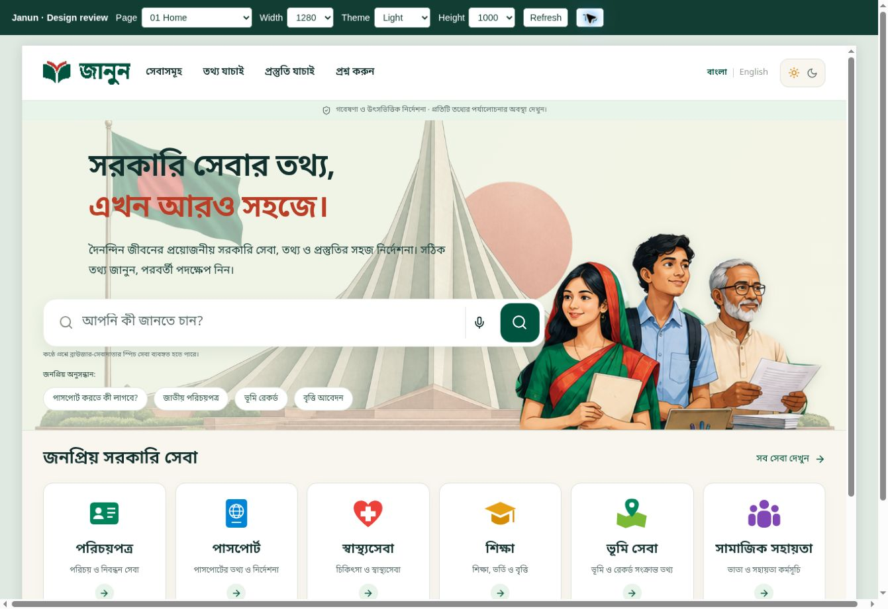
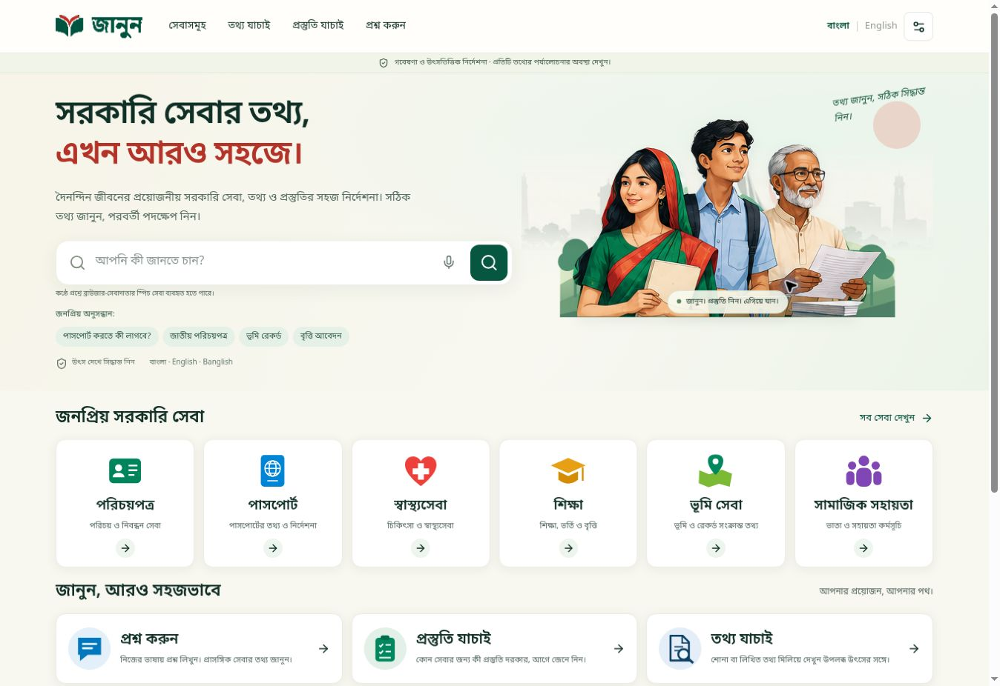

> **Historical handover:** this file preserves an earlier implementation report and its original screenshots. For the current live-app images and vector logo, see the [current README](../README.md).

# জানুন · Janun

## Nine-board UI update · October 2026

All nine supplied design areas now share responsive forest/ivory and dark themes, real interactive layouts, preserved data and evidence states, local OCR, and working device preview. Read the [board-by-board implementation report](../docs/design-implementation-v4.md), [setup and deployment guide](../docs/deployment-v4.md), and [raw validation evidence](../docs/validation/v4/). The report identifies every remaining backend, AI, feedback and source-review limit. Screenshots cover all 11 mapped views in four display combinations. Historical milestone notes below remain for context.




An independent Bangladesh citizen-service guide with a Bangla-first, green-and-ivory interface. This update retains the Next.js/TypeScript frontend, FastAPI API, PostgreSQL/pgvector architecture, source review gates and original team data.



## October 2026 v3 update

Includes Light/Dark/System, a functioning phone/tablet preview, compact reference-based layouts, all-service readiness discovery, age/location passport branching, fee tables, primary-source page captures, bounded supported/contradicted/partial claim comparison, source classification, and source-linked research journeys. Original catalogue data/review states are unchanged.

**Full live integration remains blocked:** the existing Vercel Janun project's team scope returns 403, the current Sites publication has no configured API/database/AI runtime values, and no real provider-backed request has succeeded. Do not interpret the working research preview as a live-AI deployment.

Read the [complete requirements/status report](../docs/completion-checklist-v3.md), [deployment/configuration guide](../docs/deployment-v3.md), and [all-record coverage report](../docs/service-coverage-v3.json). Historical documentation below describes earlier milestones; these v3 reports take precedence for current feature scope and validation.

## What changed

- Responsive homepage with supplied SVG branding, service icons and citizen illustration.
- Search-first question submission, Bangla/English interface, Banglish intent matching and honest research-search fallback.
- Reusable service guide with requirement, source and genuine document tabs.
- Service-specific preparation checklist with progress, yes/no/not-sure responses, editing, restart and deterministic results.
- Dedicated information-check page with editable extracted text, 8 MB upload validation, PDF text extraction and browser-local Bangla/English OCR. No uploaded file is sent to a server.
- Conservative claim-by-claim comparison, explicit evidence gaps and document-authentication disclaimer.
- User-initiated microphone transcription and answer playback where installed browser support permits; text fallback otherwise.
- Source directory and retained access to categories, journeys, source administration and policy pages.

## Content and hosting modes

The current snapshot contains **271 service entries**. The five uploaded DOCX files now supply 84 canonical updates: 53 replacements and 31 additions, with 14 duplicate routes consolidated. All 254 former links resolve, and 187 unrelated entries are unchanged. The original **5,037-row** research catalogue remains intact. Source-confirmed document evidence is distinguished from independent review, with no fabricated verification dates. See [the update report](../docs/document-data-update.md) and [service mapping](../docs/document-service-map.csv).

**The existing hosted Site is a static research preview.** It does not host FastAPI, PostgreSQL, an LLM provider, source administration writes, persistent feedback or personalized journey generation. Unsupported operations explain the limit. A recorded source URL is not independent verification of its contents.

Set `NEXT_PUBLIC_DEMO_MODE=false` to build the full Next.js server connected to the retained FastAPI backend. Its publication gates continue to expose only current, human-reviewed source claims. Do not use the unreviewed preview as authoritative guidance.

## Static preview setup

```bash
npm ci
npm run prepare:assets
npm run dev
```

For local development, copy `.env.example` to `.env.local` and keep `NEXT_PUBLIC_DEMO_MODE=true` for research mode. The committed `.env.production` deliberately enables research mode for the existing static Site.

```bash
npm run typecheck
npm test
npm run build
```

The production export appears in `out/`. A separate HTTPS backend can be connected at build time using `NEXT_PUBLIC_API_BASE_URL`; see the v3 deployment guide. It includes generated routes for all services and categories. Serve it with a static host that supports directory `index.html` files. Do not open it as a `file://` URL.

## Full application setup

The Next.js frontend lives at the repository root; FastAPI lives in `backend/`.

```bash
cp .env.example .env
# Set POSTGRES_PASSWORD to a long random password.
# Configure API credentials only on the backend, if live AI is needed.
docker compose up --build
```

Docker builds the frontend with `NEXT_PUBLIC_DEMO_MODE=false`, uses the server-only `BACKEND_URL=http://api:8000`, runs existing migrations and seeds/imports team research through the original review workflow. The app binds locally to `http://localhost:3000`. No new database migration is required by this UI update.

Docker execution and a live PostgreSQL/pgvector deployment were not available in this session; see the validation report. For a manual server build, set `NEXT_PUBLIC_DEMO_MODE=false` in the process environment (which overrides `.env.production`) and `BACKEND_URL` before `npm run build`, then run the standalone server. Configure HTTPS and your own origin before public deployment.

Backend development and tests:

```bash
python -m venv .venv
.venv/bin/pip install -r backend/requirements.txt
cd backend
../.venv/bin/python -m pytest -q
```

Backend environment examples are in `backend/.env.example`. Live AI requires `OPENAI_API_KEY`, `LLM_MODEL`, and optional `EMBEDDING_MODEL` with matching `EMBEDDING_DIMENSIONS`. No credentials are embedded in frontend source.

## Evidence and decisions

Readiness uses recorded document/eligibility text. It does not invent narrower conditions from prose. Optional structured `readiness_questions` support explicit conditional dependencies when a reviewed dataset supplies them. Unknown or inapplicable conditions should be marked “Not sure” and confirmed with the authority. Unreviewed data never produces a confirmed readiness result.

`POST /api/check` accepts bounded text, a published service slug and `bn`/`en`. It compares at most 20 statements against applicable evidence. Two explicitly scoped passport instruction concepts have bounded supported/contradicted/partial rules with original-source links; other reviewed structured requirements retain conservative exact matching. Missing or uncovered evidence yields `insufficient`. It deliberately does not infer contradiction from absence, or label a person fraudulent. Broader semantic verdicts require additional reviewed claim-level evidence/provider configuration and are not fabricated here.

## Browser files and voice

PDF.js and Tesseract load on demand. Worker code, WebAssembly and Bangla/English language data are served from `public/pdf` and `public/ocr`. `npm run prepare:assets` copies workers from the installed packages; retained language models are already included. Document contents stay in the browser in research mode. Full-backend comparison sends only the user-reviewed text to `/api/check`, does not store it, and returns `Cache-Control: no-store`.

File limits: PDF/PNG/JPEG/WebP; 8 MB; 10 PDF pages; 16 megapixel images; 20,000 extracted characters. File signatures are checked. Scripts inside PDF files are not executed. Scanned PDF pages use OCR when necessary. Unreadable/low-confidence files produce an error and a paste-text fallback. Files, extracted text and readiness answers are not saved across page reloads. Uploaded data is never treated as application instructions.

Voice recognition can use the browser vendor's speech service. It starts only after a click. Bangla/English playback requires an installed corresponding voice. Microphone permission, HTTPS and browser support are required. No real microphone recording or audio playback was tested in this session; unsupported-recognition fallback was tested.

## Later five-document update

The five new Word documents have been integrated. Originals, hashes and complete extracted content are under `research/documents-2026-10-25/`. Explicit mappings replace current fields and retain older values in `docs/validation/document-replacement-ledger.json`. Reproduce the release with `python scripts/import_document_release.py` followed by `python scripts/build_demo_data.py`. The earlier staging command below remains available for future, unreviewed intake.

```bash
python scripts/import_updated_documents.py /path/to/five-new-docx /path/to/pending-intake
```

This bounded intake extracts paragraphs (including tables), hyperlinks, embedded evidence and SHA256 provenance into a pending-review JSON file. Reviewers must map claims to services, reconcile duplicates/conflicts, record effective dates and independently review official evidence using the existing source workflow. Intake never marks a claim verified or auto-publishes it. It does not infer “not required” from missing text.

Regenerate the research snapshot, if necessary, using `python scripts/build_demo_data.py`. It preserves the original provenance and review status. Build again after generation to update static routes.

## Structure

```text
src/app/                    Next.js routes and shared theme
src/components/             Homepage, guide, readiness, checking, voice, existing app views
src/lib/                    API adapter, research retrieval, deterministic policies, extraction
public/ui/                  Supplied logos, icons, illustrations and provenance manifest
public/pdf/ public/ocr/      Local PDF/OCR worker assets and language data
backend/app/                FastAPI, retrieval, review, claim comparison
backend/migrations/         Existing PostgreSQL schema migrations
backend/data/               Original team catalogue
scripts/                    Data generation, staged document intake, browser asset preparation
tests/ backend/tests/       Frontend and API/domain regression checks
docs/                       Handover and historical project documentation
team-data-originals/        Unmodified original team ZIP datasets
```

See [the current v3 status, validation and limitations](../docs/completion-checklist-v3.md). Historical files in `docs/` describe earlier milestones and may reference an older folder layout or Site identity; this README and the new validation report describe the current update.
